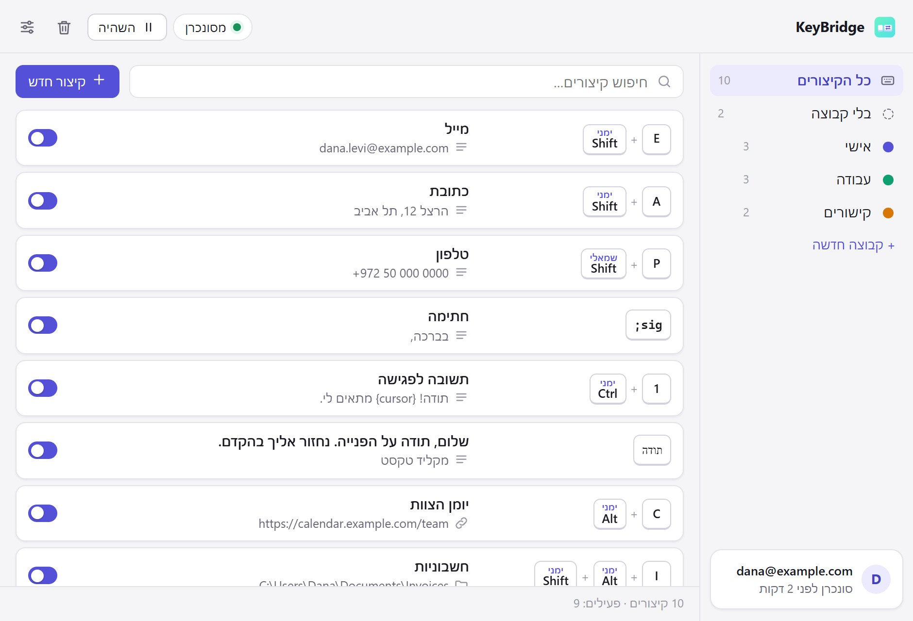

<div dir="rtl">

# KeyBridge

**לחיצה אחת. וזה מוקלד.** בכל מחשב שמחובר לחשבון שלך.
קיצורי טקסט וקיצורי מקלדת ל-Mac ול-Windows, חינם ובקוד פתוח. Shift, Ctrl, Alt ו-Win / Cmd הימניים והשמאליים הם מקשים שונים, והקיצורים שלך נמצאים בכל מחשב שמחובר לחשבון, נעולים כך שרק אתה יכול לקרוא אותם.

[אתר וסרטון הדגמה](https://aiworldbyshachar.github.io/keybridge/) · [הורדה ל-Windows](https://github.com/aiworldbyshachar/keybridge/releases/latest/download/KeyBridge-Windows-Setup.exe) · [הורדה ל-Mac](https://github.com/aiworldbyshachar/keybridge/releases/latest/download/KeyBridge-macOS.dmg) · [English](README.md)

<p align="center"><a href="https://aiworldbyshachar.github.io/keybridge/"></a></p>

אני מקליד את אותה כתובת מייל, אותו מספר טלפון ואותם קישורים עשרים פעם ביום. במשך שנים כלי קטן ל-Windows עשה את זה בשבילי: Shift ימני + E הקליד את המייל, ו-Shift שמאלי + E נשאר E גדולה. אבל הוא חי במחשב אחד, אז במק, או במחשב חדש, כל הקיצורים נעלמו. KeyBridge עושה את אותה עבודה בשניהם, והקיצורים שלך עוברים איתך.

- **ימין ושמאל הם מקשים שונים**: Shift ימני + A יכול להקליד את הכתובת שלך, ו-Shift שמאלי + A נשאר A גדולה. Shift, Ctrl, Alt (Option במק) ו-Win (Cmd), כל צד בנפרד, או כל אחד מהצדדים אם מעדיפים.
- **צירופי מקשים ומילות קיצור**: לוחצים על צירוף מקשים, או מקלידים מילה קצרה כמו `;sig` ואחריה Space או Tab. מילות קיצור נבדקות לפי המקשים שנלחצו, אז הן עובדות גם כשהמקלדת על עברית וגם כשהיא על אנגלית.
- **מקליד טקסט, פותח קישורים, תיקיות ותוכנות**: טקסט קצר מוקלד אות אחר אות. טקסט ארוך או של כמה שורות מודבק, ולוח העריכה שלך חוזר מיד אחרי (תוכנות שמנהלות את לוח העריכה, גם ClipBridge, מתעלמות ממנו). הטקסט יכול לכלול את התאריך, השעה, מה שבלוח העריכה, ואיפה הסמן יעמוד בסוף.
- **בכל מחשב שמחובר לחשבון**: נכנסים עם המייל (בלי סיסמה) בכל Mac ו-PC, מקלידים את הקוד פעם אחת, והקיצורים שם ונשארים מעודכנים. המקשים מותאמים לפי התפקיד: Alt ימני ב-Windows הוא Option ימני במק, Win ימני הוא Cmd ימני. כשמקש לא קיים במקלדת של המערכת השנייה, KeyBridge אומר את זה ומציע מקש אחר.
- **רק אתה יכול לקרוא אותם**: הקיצורים ננעלים במחשב שלך עם קוד של 12 תווים שרק לך יש (AES-256-GCM), עוד לפני שהם נשלחים לאנשהו. השרת שומר אותם נעולים, ואפילו אני לא יכול לקרוא אותם. בלי להיכנס לחשבון, שום דבר לא יוצא מהמחשב.
- **אף פעם לא מקליט את מה שמוקלד**: KeyBridge רק יודע שנלחץ אחד הקיצורים שלך. בשביל מילות הקיצור הוא זוכר את המקשים האחרונים בזיכרון בלבד, אף פעם לא בדיסק ואף פעם לא נשלחים לשום מקום.
- **שום דבר לא הולך לאיבוד**: קיצורים שנמחקו, וגרסאות שהוחלפו בייבוא או ממחשב אחר, נשמרים בסל המחזור 30 יום, עם שחזור. אם שני מחשבים שינו את אותו קיצור לפני שהספיקו להסתנכרן, השינוי המאוחר מנצח והשני נשמר בסל המחזור בתור "גרסה ישנה יותר".
- **קבוצות, חיפוש והשהיה**: קבוצות בצבעים, חיפוש, כיבוי של קיצור או של קבוצה שלמה, אזהרה כששני קיצורים משתמשים באותם מקשים, ולחיצה אחת שמשהה הכל למשחקים או לשולחן עבודה מרוחק.
- **ייבוא הקיצורים מ-Clavier+** (Windows): KeyBridge מוצא אותם ומביא אותם עם המקשים הימניים והשמאליים שלהם. ייצוא וייבוא של קובץ JSON לגיבוי.
- **שש שפות**: אנגלית (ברירת מחדל), עברית, ספרדית, צרפתית, רוסית וערבית. עברית וערבית מימין לשמאל.
- **חינם וקוד פתוח** ברישיון MIT.

> **הכלל היחיד:** כדי להשתמש בקיצורים ביותר ממחשב אחד, נכנסים עם אותו מייל בכל מחשב ומקלידים את הקוד פעם אחת בכל מחשב חדש. בלי להיכנס לחשבון, KeyBridge עובד במלואו במחשב אחד.

## התקנה

- **Windows 10/11**: הורד את `KeyBridge-Windows-Setup.exe` והרץ. אם מופיע "Windows protected your PC", לחץ **More info** ואז **Run anyway**. KeyBridge נפתח, ומאז הוא עולה בשקט עם Windows.
- **macOS 12 ומעלה** (Apple Silicon ו-Intel): הורד את `KeyBridge-macOS.dmg`, פתח וגרור את KeyBridge ל-Applications. בפתיחה הראשונה, אם macOS לא מצליח לאמת את האפליקציה: הגדרות המערכת ← פרטיות ואבטחה ← **Open Anyway**. אחר כך אשר את KeyBridge תחת פרטיות ואבטחה ← **נגישות** (בחלון יש כפתור שמוביל לשם). זה מה שמאפשר לו לראות את הקיצורים שלך. אם מופיע שהאפליקציה "פגומה" (damaged), הרץ פעם אחת בטרמינל: `xattr -cr /Applications/KeyBridge.app`

האפליקציות לא חתומות בתעודות מפתחים בתשלום של Apple ו-Microsoft, ולכן שתי המערכות שואלות פעם אחת.

## הקיצורים שלך במחשבים נוספים

1. במחשב הראשון: לחץ **כניסה** בפינה התחתונה של חלון KeyBridge, הקלד את המייל ולחץ **שליחת קוד**.
2. הקלד את הקוד בן 6 הספרות מהמייל (אפשר לקרוא אותו גם בטלפון או בכל מכשיר אחר), או לחץ על הקישור שבמייל באותו מחשב. אחר כך KeyBridge מציג את הקוד שלך, למשל `K7QM-4XRT-P9WE`. רשום אותו.
3. בכל מחשב נוסף: מתקינים את KeyBridge, נכנסים באותה דרך ומקלידים את הקוד פעם אחת. הקיצורים מופיעים, ומאז כל שינוי מגיע לכל המחשבים תוך שניות.

שכחת את הקוד? כל מחשב שעדיין מחובר מציג אותו שוב תחת **חשבון ← הצגת הקוד שלי**.

הממשק באנגלית? Settings ← Language ← עברית.

## שימוש

- **קיצור חדש** ← **הקלטת מקשים** (לוחצים עליהם) או **מילת קיצור** ← מה הוא עושה: **טקסט**, **קישור**, **תיקייה או קובץ** או **תוכנה** ← **שמירה**. אפשר לנסות מיד, בכל אפליקציה.
- **האייקון במגש או בשורת התפריטים**: פתיחת KeyBridge, קיצור חדש, השהיית הקיצורים, סנכרון, הגדרות.
- **סל המחזור**: אייקון הפח בראש החלון. שחזור מחזיר קיצור לכל המחשבים.
- **המחשבים שלך**: חשבון ← המחשבים שלך. אפשר לנתק מחשב שכבר אין לך. הוא מתנתק בעצמו תוך דקה ושומר את הקיצורים שלו.
- **הגדרות**: שפה, הפעלה עם הכניסה למחשב, ייבוא מ-Clavier+, ייצוא לקובץ וייבוא מקובץ, השם של המחשב הזה.

## איפה הנתונים

- במחשב: בתיקיית הנתונים של KeyBridge (`%APPDATA%\KeyBridge` ב-Windows, `~/Library/Application Support/KeyBridge` במק). פרטי הכניסה והקוד נמצאים שם ב-`secrets.json`: ב-Windows הוא נעול באחסון המאובטח של המערכת, ובמק רק המשתמש שלך יכול לקרוא אותו.
- בענן, כשאתה מחובר: כתובת המייל, הקיצורים, הקבוצות וסל המחזור (נעולים עם הקוד שלך), שמות המחשבים (גם הם נעולים), האם כל אחד הוא Mac או PC ומתי נראה לאחרונה. הפרטים המלאים ב[דף הפרטיות](https://aiworldbyshachar.github.io/keybridge/privacy.html). **חשבון ← התנתקות או מחיקה ← מחיקת החשבון** מוחק את כל זה, והקיצורים נשארים במחשבים שלך.

## פתרון בעיות

- **קיצור לא עובד באפליקציה מסוימת**: ב-Windows, אפליקציות שרצות כמנהל (כמו מנהל המשימות) מופרדות מאפליקציות רגילות, והקיצורים לא מגיעים אליהן. במק, שדות סיסמה חוסמים כל אפליקציה שמאזינה למקלדת, וזה בכוונה.
- **שום דבר לא עובד במק**: הגדרות המערכת ← פרטיות ואבטחה ← נגישות ← KeyBridge צריך להיות מופעל. אם אחרי התקנת גרסה חדשה הקיצורים הפסיקו, הסר את KeyBridge מהרשימה והוסף אותו שוב.
- **המייל לא מגיע, או שהקוד שבו לא עובד**: בדוק בספאם. הקוד עובד פעם אחת, במשך שעה - לחץ ביטול ושלח חדש. הקישור שבמייל עובד רק במחשב שבו אתה נכנס, הקוד עובד מכל מקום. "יותר מדי ניסיונות" אומר לחכות כמה דקות.
- **אנטי-וירוס מתלונן**: כל אפליקציה שמאזינה לצירופי מקשים עלולה להיראות לו חשודה. כל הקוד של KeyBridge נמצא כאן, והדבר היחיד שהוא שולח הוא הקיצורים הנעולים שלך, ורק כשאתה מחובר.
- **יומן לפתרון בעיות**: הגדרות ← פתיחת תיקיית הנתונים ← `keybridge.log`. הוא אף פעם לא כולל את מה שהקלדת או את תוכן הקיצורים.

## בנייה מהקוד

```bash
npm install
npm run helper
npm start
npm test
```

צריך Rust בשביל רכיב המקלדת. פרטים טכניים מלאים ב-[README באנגלית](README.md).

## עוד כלים חינמיים

- [ClipBridge](https://github.com/aiworldbyshachar/clipbridge): מעתיקים במק, מדביקים בפיסי, עם היסטוריית העתקות משותפת.
- [FolderBridge](https://github.com/aiworldbyshachar/folderbridge): תיקייה אחת, זהה במק ובפיסי.

</div>
