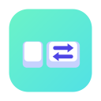
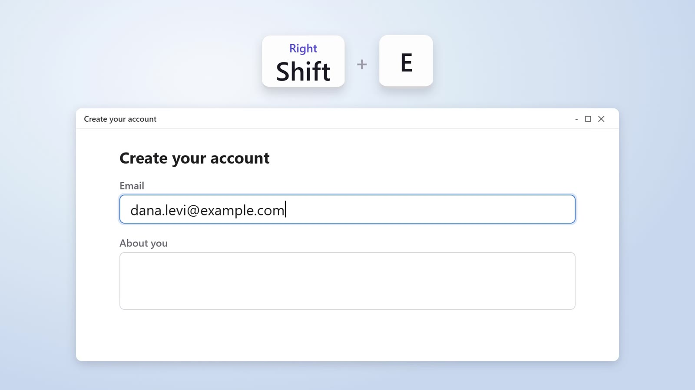

<p align="center"></p>

<h1 align="center">KeyBridge</h1>

<p align="center"><b>Press it once. It's typed.</b> On every computer you sign in to.<br>
Free, open-source text shortcuts and hotkeys for Mac and Windows - with left and right Shift, Ctrl, Alt and Win / Cmd as different keys, and your shortcuts on each computer you sign in to, locked so only you can read them.</p>

<p align="center">
  <a href="https://aiworldbyshachar.github.io/keybridge/">Website &amp; demo video</a> ·
  <a href="https://github.com/aiworldbyshachar/keybridge/releases/latest/download/KeyBridge-Windows-Setup.exe">Download for Windows</a> ·
  <a href="https://github.com/aiworldbyshachar/keybridge/releases/latest/download/KeyBridge-macOS.dmg">Download for Mac</a> ·
  <a href="README.he.md">עברית</a>
</p>

<p align="center"><a href="https://aiworldbyshachar.github.io/keybridge/#demo"></a></p>

---

I type the same email address, phone number and links twenty times a day. For years a small Windows tool did it for me: Right Shift + E typed my email, while Left Shift + E was still a capital E. But it lived on one PC, so on my Mac, or on a new computer, every shortcut was gone. KeyBridge does the same job on both, and brings your shortcuts along.

- **Left and right are different keys.** Right Shift + A can type your address while Left Shift + A is still a capital A. Shift, Ctrl, Alt (Option on the Mac) and Win (Cmd), each side on its own - or either side, if you prefer.
- **Hotkeys and abbreviations.** Press a key combination, or type a short word like `;sig` and then Space or Tab. Abbreviations go by the keys you press, so they fire on the English and the Hebrew layout alike.
- **Types text, opens links, folders and programs.** Short text is typed in, letter by letter. Long or multi-line text is pasted, and your clipboard comes back right after (clipboard managers, ClipBridge too, are told to skip it). Text can hold today's date, the time, what's on the clipboard, and where the cursor should end up.
- **On every computer you sign in to.** Sign in with your email (no password) on each Mac and PC, type your code once, and your shortcuts are there and stay in step. Keys are matched by what they do: Right Alt on Windows is Right Option on the Mac, Right Win is Right Cmd. When a key doesn't exist on the other keyboard, KeyBridge says so and suggests another.
- **Only you can read them.** Your shortcuts are locked on your computer with a 12-character code only you have (AES-256-GCM) before they go anywhere. The server keeps them locked - not even I can read them. Without signing in, nothing leaves your computer.
- **It never records what you type.** KeyBridge only learns that one of your shortcuts was pressed. For abbreviations it keeps the last few keys in memory - never on disk, never sent anywhere.
- **Nothing is ever lost.** Deleted shortcuts, and versions replaced by an import or by another computer, wait in the Trash for 30 days, with Restore. If two computers changed the same shortcut before they could sync, the later change wins and the other one is kept in the Trash as "Older version".
- **Groups, search and pause.** Colored groups, search, switch a shortcut or a whole group off, a warning when two shortcuts use the same keys, and one click to pause everything for games or remote desktop.
- **Bring in your Clavier+ shortcuts** (Windows). KeyBridge finds them and brings them in with their left and right keys. Export and import a JSON file for backups.
- **Six languages.** English (default), Hebrew, Spanish, French, Russian and Arabic, with right-to-left layouts for Hebrew and Arabic.
- **Free and open source** under the MIT licence.

> **The one rule:** to use your shortcuts on more than one computer, sign in with the same email on each and type your code once on every new one. Without signing in, KeyBridge works fully on one computer.

## Install

| | |
|---|---|
| **Windows 10/11** | Download [`KeyBridge-Windows-Setup.exe`](https://github.com/aiworldbyshachar/keybridge/releases/latest/download/KeyBridge-Windows-Setup.exe) and run it. If SmartScreen says "Windows protected your PC", click **More info → Run anyway**. KeyBridge opens, and from then on starts quietly with Windows. |
| **macOS 12+** (Apple Silicon & Intel) | Download [`KeyBridge-macOS.dmg`](https://github.com/aiworldbyshachar/keybridge/releases/latest/download/KeyBridge-macOS.dmg), open it and drag KeyBridge to Applications. On first launch, if macOS can't verify the app, go to **System Settings → Privacy & Security → Open Anyway**. Then allow KeyBridge under **Privacy & Security → Accessibility** (the window has a button that takes you there) - that's what lets it see your shortcuts. If macOS says the app is "damaged", run `xattr -cr /Applications/KeyBridge.app` once in Terminal. |

The apps aren't signed with paid Apple/Microsoft developer certificates - that's why both systems ask once. You can also [build from source](#build-from-source).

## Use your shortcuts on more computers

1. On your first computer, click **Sign in** at the bottom left of the KeyBridge window, type your email and click **Send link**.
2. Open the email **on that same computer** and click the link. KeyBridge shows your code, like `K7QM-4XRT-P9WE`. Write it down.
3. On every other computer: install KeyBridge, sign in the same way, and type the code once. Your shortcuts appear, and from then on changes reach every computer within seconds.

Lost the code? Any computer that's still signed in shows it again under **Account → Show my code**.

## Use it

- **New shortcut** → **Record keys** (press them) or **Abbreviation** → what it does: **Text**, **Link**, **Folder or file** or **Program** → **Save**. Try it right away, in any app.
- **The tray / menu-bar icon:** open KeyBridge, a new shortcut, pause shortcuts, sync now, settings.
- **Trash:** the bin icon at the top of the window. Restore puts a shortcut back on every computer.
- **Your computers:** Account → Your computers. Sign out a computer you no longer have; it signs itself out within a minute and keeps its shortcuts.
- **Settings:** language, open at login, import from Clavier+, export to a file and import one, this computer's name.

## Where your data lives

| | Windows | macOS |
|---|---|---|
| Shortcuts, trash, settings, log | `%APPDATA%\KeyBridge` | `~/Library/Application Support/KeyBridge` |
| Your sign-in and code | `secrets.json` there, sealed with Windows' secure storage | `secrets.json` there, readable only by your user |

In the cloud, while you're signed in: your email address, your shortcuts, groups and trash (locked with your code), your computers' names (locked too), whether each is a Mac or a PC and when it was last seen. The [privacy page](https://aiworldbyshachar.github.io/keybridge/privacy.html) has the details. **Account → Sign out or delete → Delete account** removes all of it; your shortcuts stay on your computers. Uninstalling keeps KeyBridge's data folder.

## Troubleshooting

- **A shortcut doesn't fire in one app.** On Windows, apps run as administrator (like Task Manager) are kept apart from normal apps, so shortcuts don't reach them. On the Mac, password fields block every app that watches the keyboard - that's on purpose.
- **Nothing fires on the Mac.** System Settings → Privacy & Security → Accessibility → KeyBridge must be on. After installing a new version, if shortcuts stop, remove KeyBridge from that list and add it again.
- **The sign-in link doesn't finish signing in.** Open it on the computer you're signing in on - KeyBridge waits for it there. "Too many tries" means wait a few minutes.
- **An antivirus program complains.** Any app that watches for hotkeys can look suspicious to them. KeyBridge's code is all here; it sends out nothing but your locked shortcuts, and only when you're signed in.
- **Something else?** Settings → Open data folder → `keybridge.log` (it never contains what you type or what your shortcuts say), and [open an issue](https://github.com/aiworldbyshachar/keybridge/issues).

## How it works

- [`native/`](native) is a small Rust helper that watches the keyboard: a low-level keyboard hook on Windows, an event tap on the Mac. It tells left from right, swallows the keys of a matched hotkey, and types text as Unicode, whatever the keyboard layout. It talks to the app in JSON lines and only ever reports "shortcut X fired"; the last few keys it keeps for abbreviations stay in its memory.
- `src/main/engine.js` keeps the helper's hotkeys in step with your shortcuts and runs them; `triggers.js` maps keys between Windows and the Mac; `abbrev.js` turns abbreviations into physical keys (so `;addr` also fires when typed on the Hebrew layout); `variables.js` fills in date, time, clipboard and cursor.
- `src/main/store.js` keeps shortcuts, groups and the 30-day trash in `shortcuts.json`.
- `src/main/vault.js` locks everything that goes to the cloud: key = `scrypt(code, 'keybridge/v1', 32)`, AES-256-GCM. The server sees only ids, revision numbers, sizes, deleted flags, device ids and times.
- `src/main/sync.js`, `cloud.js` and `realtime.js` sync with a Supabase project (Postgres with row-level security; the tables and functions are in [`supabase/migrations`](supabase/migrations)) over plain HTTPS, no Supabase library. The later change wins and the other goes to the trash; an edit always beats a delete.
- `src/main/signin.js` catches the email link on `localhost:47822` (PKCE: the link is worth nothing without a secret that never leaves the computer). `clavier.js` reads Clavier+'s settings file. `main.js` is the tray, window and IPC; the UI is in `src/renderer`, all strings in all languages in `src/shared/i18n.js`.

## Build from source

```bash
npm install
npm run helper       # the keyboard helper - needs Rust (rustup.rs)
npm start            # run from source
npm test             # engine, sync, import, SQL and translation tests
npm run dist:win     # Windows installer → dist/
npm run dist:mac     # macOS DMG → dist/ (on a Mac)
```

Without a cloud set up, KeyBridge runs on one computer only. To sync through your own Supabase project, run `supabase/migrations/0001_init.sql` in it, allow `http://localhost:47822/auth` as a redirect URL, and put `KEYBRIDGE_SUPABASE_URL` and `KEYBRIDGE_SUPABASE_KEY` (the publishable key, never the secret one) in a `.env` file - it's gitignored. The installers need both values.

`node dev/serve.js` previews the window in a browser with made-up shortcuts, `npm run demo` runs the keyboard engine in a terminal, and `node dev/site-shots.js` takes the website's pictures from the real window. Releases are built by GitHub Actions: pushing a tag like `v1.0.0` builds both installers and publishes them (`.github/workflows/release.yml`).

## Contributing

Issues and pull requests are welcome. Good first ideas: more languages (add a table to `src/shared/i18n.js`), importing from other snippet tools, Linux support.

## More free tools

- [ClipBridge](https://github.com/aiworldbyshachar/clipbridge) - copy on your Mac, paste on your PC, with one shared clipboard history.
- [FolderBridge](https://github.com/aiworldbyshachar/folderbridge) - one folder, identical on your Mac and your PC.

## Licence

[MIT](LICENSE) - free to use, change and share.
